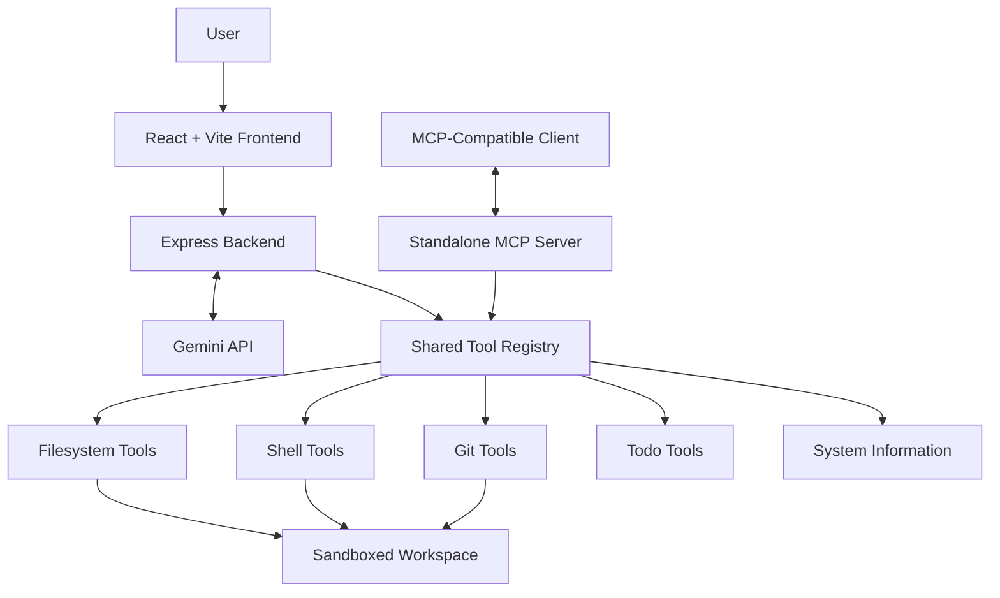
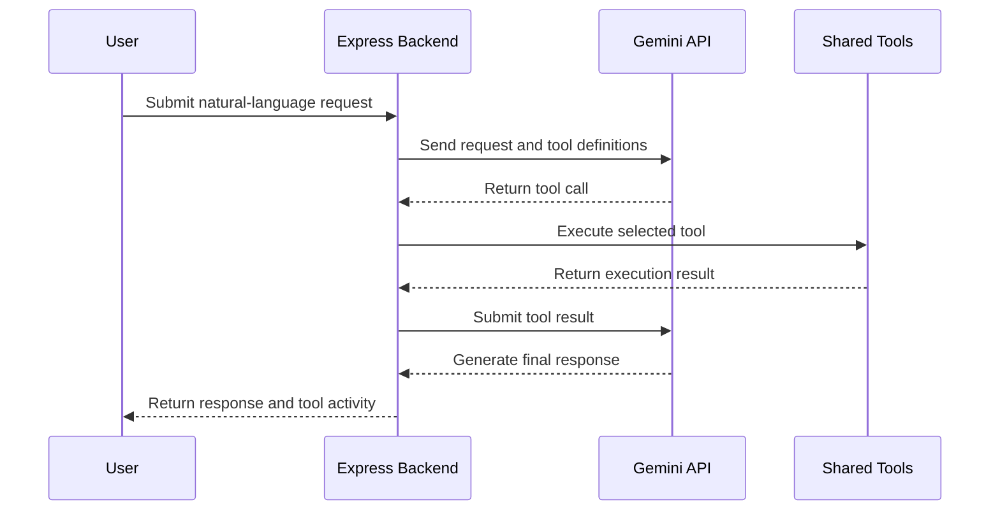

# Personal Developer MCP Server

### An AI-Powered Developer Assistant Built with Gemini, Model Context Protocol, Node.js & React

Build, inspect, and manage software projects through natural language. **Personal Developer MCP Server** is a full-stack AI developer assistant that combines Gemini function calling with the Model Context Protocol (MCP) to execute developer tools, manage files, inspect Git repositories, and automate development workflows inside a controlled local workspace.

Unlike a basic chatbot that only generates code, this project enables an AI model to **select tools, execute actions, inspect results, and combine multiple operations into a single workflow.**

It provides two integration modes: a Gemini-powered web application and a standalone MCP server compatible with MCP-enabled clients.

<p align="center">
  <strong>Natural Language → AI Reasoning → Tool Execution → Results</strong>
</p>

---

## Table of Contents

* [Overview](#overview)
* [Key Features](#key-features)
* [Architecture](#architecture)
* [Tech Stack](#tech-stack)
* [Available Developer Tools](#available-developer-tools)
* [Project Structure](#project-structure)
* [Getting Started](#getting-started)
* [Running the Application](#running-the-application)
* [Connecting an MCP Client](#connecting-an-mcp-client)
* [Example Workflows](#example-workflows)
* [Security and Safety](#security-and-safety)
* [Testing](#testing)
* [Current Limitations](#current-limitations)
* [Roadmap](#roadmap)
* [Use Cases](#use-cases)
* [Contributing](#contributing)
* [License](#license)

---

## Overview

Personal Developer MCP Server explores how AI agents can interact with real development environments through standardized tools rather than relying exclusively on text generation.

The system consists of three applications:

| Component             | Responsibility                                                                         |
| --------------------- | -------------------------------------------------------------------------------------- |
| **React + Vite**      | Interactive developer chat interface and tool execution visualization                  |
| **Node.js + Express** | Backend API, Gemini integration, and tool execution                                    |
| **MCP Server**        | Exposes developer tools to compatible AI clients through standard input/output (stdio) |

The core design principle is **shared tool logic**. Both the web application and the standalone MCP server use the same implementation from `backend/tools/`, reducing duplicated code and keeping tool behavior consistent.

### Two ways to use the project

**1. Gemini-powered web application**

Interact with the assistant through a browser. Gemini determines which tools to call, the backend executes the requested operations, and the model uses the returned results to formulate its response.

**2. Standalone MCP server**

Connect the developer tools to compatible MCP clients, such as Claude Desktop or Cursor, without requiring the Gemini-powered web interface.

---

## Key Features

### AI Agent with Tool Calling

* Integrates the Google Gemini API with function calling.
* Converts natural-language requests into structured tool calls.
* Processes tool results and returns context-aware responses.
* Supports multiple tool calls within a single interaction.
* Enables multi-step developer workflows.

### Standardized MCP Integration

* Implements a standalone MCP server using the MCP SDK.
* Communicates through stdio.
* Exposes the shared developer toolset to compatible MCP clients.
* Keeps the tool implementation independent of a specific AI interface.

### Workspace-Aware File Operations

* Read, create, and update files.
* List files and directories.
* Delete workspace files.
* Search project files for matching text.
* Restrict normal file-tool operations to the configured workspace.

### Controlled Command Execution

* Provides a predefined shell-command allowlist.
* Supports selected development commands, including Node.js, npm, Git, Python, and common file utilities.
* Rejects commands outside the configured allowlist.
* Avoids intentionally providing unrestricted shell access to the model.

### Git-Aware Development Workflows

* Inspect repository status.
* Review code changes using Git diff.
* Explore commit history.
* Create Git commits through the available tool interface.

### Built-In Development Task Management

* Create development tasks.
* View existing tasks.
* Mark tasks as completed.
* Combine code-search results with task creation.

### Transparent Tool Execution

The frontend includes dedicated tool-call cards that can display:

* Tool name
* Input arguments
* Execution result

This makes the agent's actions easier to inspect and debug.

---

## Architecture

### System Overview



### Gemini Function-Calling Lifecycle



The backend manages the interaction between Gemini and the local tool layer. When Gemini requests a tool, the backend executes it and provides the result to the model so it can continue the workflow.

### Why a Shared Tool Layer?

Both integrations depend on the same implementation:

```text
                 ┌─────────────────────┐
                 │   Shared Tool Layer │
                 │ backend/tools/      │
                 └──────────┬──────────┘
                            │
                ┌───────────┴───────────┐
                │                       │
        Gemini Web App           MCP Server
        Express + React          stdio + MCP
```

This separation improves maintainability, avoids duplicated tool implementations, and makes it easier to introduce additional AI clients in the future.

---

## Tech Stack

| Category             | Technologies                                |
| -------------------- | ------------------------------------------- |
| AI Integration       | Google Gemini API, Function Calling         |
| Agent Tool Protocol  | Model Context Protocol (MCP)                |
| Backend              | Node.js, Express.js, JavaScript             |
| Frontend             | React, Vite, JavaScript                     |
| API Communication    | REST, HTTP, JSON                            |
| Developer Operations | Git, Node.js child processes                |
| System Integration   | Filesystem APIs, OS and process information |
| Package Management   | npm                                         |

---

## Available Developer Tools

All tools are registered through `backend/tools/` and reused by the web application and MCP server.

| Tool                | Description                                                |
| ------------------- | ---------------------------------------------------------- |
| `read_file`         | Read a file inside the workspace                           |
| `write_file`        | Create or overwrite a workspace file                       |
| `list_directory`    | List files and directories                                 |
| `delete_file`       | Delete a workspace file                                    |
| `search_code`       | Search project files for matching text                     |
| `run_shell_command` | Execute commands permitted by the configured allowlist     |
| `git_status`        | Inspect repository status                                  |
| `git_diff`          | Review changes to tracked files                            |
| `git_log`           | Inspect commit history                                     |
| `git_commit`        | Create a Git commit                                        |
| `add_todo`          | Add a development task                                     |
| `list_todos`        | Display existing tasks                                     |
| `complete_todo`     | Mark a task as completed                                   |
| `get_system_info`   | Retrieve selected OS, Node.js, CPU, and memory information |

**Note:** Actual behavior and restrictions depend on each tool's implementation and configuration.

---

## Project Structure

```text
personal-dev-mcp-server/
│
├── backend/
│   ├── server.js
│   ├── gemini.js
│   ├── .env.example
│   ├── package.json
│   │
│   ├── tools/
│   │   ├── index.js
│   │   ├── filesystem.js
│   │   ├── shell.js
│   │   ├── git.js
│   │   ├── notes.js
│   │   └── system.js
│   │
│   └── workspace/
│
├── mcp-server/
│   ├── index.js
│   └── package.json
│
├── frontend/
│   ├── src/
│   │   ├── App.jsx
│   │   ├── main.jsx
│   │   └── components/
│   │       ├── ChatWindow.jsx
│   │       ├── Message.jsx
│   │       └── ToolCallCard.jsx
│   ├── index.html
│   └── package.json
│
└── README.md
```

### Core modules

* `backend/server.js` — Express server and chat API.
* `backend/gemini.js` — Gemini API integration and tool-calling workflow.
* `backend/tools/index.js` — Tool registry and function schemas.
* `backend/tools/filesystem.js` — Workspace file operations.
* `backend/tools/shell.js` — Command execution restrictions.
* `backend/tools/git.js` — Git-related operations.
* `backend/tools/notes.js` — Development task management.
* `backend/tools/system.js` — System information.
* `mcp-server/index.js` — Standalone MCP server entry point.
* `frontend/src/components/ToolCallCard.jsx` — Tool execution visualization.

---

## Getting Started

### Prerequisites

Install the following before running the project:

* Node.js 18 or later
* npm
* Git
* A Gemini API key for the web application

Node.js 22 is also suitable, provided the project's dependencies support the selected runtime.

### 1. Clone the repository

```bash
git clone <your-repository-url>
cd personal-dev-mcp-server
```

Replace `<your-repository-url>` with the actual Git repository URL.

### 2. Install dependencies

The project contains three separate Node.js applications. Install dependencies in each directory.

**MCP server**

```bash
cd mcp-server
npm install
cd ..
```

**Backend**

```bash
cd backend
npm install
cd ..
```

**Frontend**

```bash
cd frontend
npm install
cd ..
```

### 3. Configure Gemini

Create an API key using [Google AI Studio](https://aistudio.google.com/apikey).

Move into the backend directory:

```bash
cd backend
```

Create your local environment file.

**Windows Command Prompt**

```cmd
copy .env.example .env
```

**Windows PowerShell**

```powershell
Copy-Item .env.example .env
```

**macOS / Linux**

```bash
cp .env.example .env
```

Add your configuration to `backend/.env`:

```env
GEMINI_API_KEY=your_gemini_api_key
PORT=8787
```

Replace the placeholder with your actual API key. Keep this file private.

### 4. Protect environment files

Ensure your `.gitignore` excludes local secrets and installed dependencies:

```gitignore
.env
.env.*
!.env.example
node_modules/
```

Review the repository's existing ignore rules before adding or replacing them. Never commit real API keys.

---

## Running the Application

### Start the backend

Open a terminal:

```bash
cd backend
npm run dev
```

If the development script is configured correctly, the server should start at:

```text
http://localhost:8787
```

The exact output depends on the implementation.

### Start the frontend

Open a second terminal:

```bash
cd frontend
npm run dev
```

Vite will print a local development URL, typically:

```text
http://localhost:5173
```

Open the URL printed in your terminal to access the developer assistant.

**Troubleshooting:** If `npm run dev` is unavailable, inspect the relevant `package.json` scripts and use the command configured by the project. Ensure the backend and frontend ports do not conflict with other applications.

---

## Connecting an MCP Client

The standalone server exposes the shared developer tools through the MCP protocol over stdio. This mode does not require the web application's Gemini API key because the connected MCP client supplies the model and manages the AI interaction.

### Claude Desktop Configuration

Locate the Claude Desktop configuration file.

**Windows**

```text
%APPDATA%\Claude\claude_desktop_config.json
```

**macOS**

```text
~/Library/Application Support/Claude/claude_desktop_config.json
```

Add the following entry, adjusting the path to match your local installation:

```json
{
  "mcpServers": {
    "personal-dev": {
      "command": "node",
      "args": [
        "C:/absolute/path/to/personal-dev-mcp-server/mcp-server/index.js"
      ]
    }
  }
}
```

Replace the example path with the actual absolute path to `mcp-server/index.js`.

Save the configuration and restart Claude Desktop. Verify that the server starts successfully and that the expected tools are discoverable.

### Other MCP-Compatible Clients

For Cursor or another compatible client, configure a local stdio MCP server using the client's supported configuration format.

The exact configuration depends on the client and its version.

---

## Example Workflows

Try these prompts after starting the web application or connecting an MCP client.

### Inspect a project

```text
List all files in my workspace and summarize the project structure.
```

### Create a file

```text
Create notes.md in the workspace with a heading called Ideas
and add three development ideas.
```

### Search the codebase

```text
Find all JavaScript files containing console.log
and show the matching file paths.
```

### Manage development tasks

```text
Add a todo to refactor the authentication module.
Then show all pending tasks.
```

### Inspect Git changes

```text
Show the current Git status and summarize the changes.
```

### Combine multiple tools

```text
Search the workspace for TODO comments, identify the important
ones, create a development task for each, and summarize the results.
```

### Build a small application

```text
Create a basic Node.js HTTP server inside the workspace.
List the created files and show the Git status afterward.
```

These examples illustrate intended workflows. Successful execution depends on the model response, available tools, permissions, repository state, and runtime configuration.

---

## Security and Safety

An AI assistant that can modify files, execute commands, or interact with Git introduces meaningful security risks. The project includes basic safeguards, but it should be treated as a local development prototype rather than a production-secure execution platform.

### Workspace Path Restrictions

Normal filesystem tool operations are intended to remain within:

```text
backend/workspace/
```

Path traversal attempts such as the following should be rejected:

```text
../../secret.txt
```

**Important:** A robust implementation must resolve canonical paths, verify that resolved paths remain inside the workspace, and account for symbolic links. A simple string-prefix check is insufficient.

### Shell Command Allowlist

The configured allowlist includes commands such as:

```text
ls, cat, node, npm, git, python3, pwd,
echo, mkdir, grep, find, wc, head, tail, date
```

The allowlist reduces the commands that can be requested, but **an allowlist alone does not guarantee safe execution**. Some permitted commands can run scripts, invoke additional programs, or access files outside the intended workspace.

For stronger isolation, use argument validation, safe process spawning without a shell where possible, execution timeouts, resource limits, and container or virtual-machine isolation.

### API Key Protection

* Store Gemini credentials in backend environment variables.
* Never expose secrets through frontend code.
* Do not commit `.env` files.
* Avoid printing API keys in logs or tool results.
* Rotate exposed credentials immediately.

### Local Development Only

The project does not currently provide production-grade authentication, authorization, or multi-user isolation.

Before exposing it to a network or deploying it publicly, implement:

* Authentication and authorization
* Per-user workspace isolation
* Strict request and argument validation
* Rate limiting and resource quotas
* Approval gates for sensitive actions
* Audit logging
* Strong execution isolation
* Secure secret management
* HTTPS and appropriate network restrictions

Do not run the assistant against sensitive repositories or valuable data without reviewing the safeguards and testing the tool implementations.

---

## Testing

The documented smoke-test workflow covers the core tool operations:

```text
write_file
    ↓
list_directory
    ↓
read_file
    ↓
search_code
    ↓
add_todo
    ↓
list_todos
    ↓
get_system_info
    ↓
git_status
```

### Negative Security Tests

**Path traversal**

Input:

```text
../../
```

Expected behavior: reject attempts to access paths outside the permitted workspace.

**Non-allowlisted command**

Input:

```bash
rm -rf /
```

Expected behavior: reject the command because it is not included in the configured allowlist.

The tool layer has been described as smoke-tested with these workflows. These checks should not be interpreted as proof of comprehensive security or complete test coverage.

For stronger verification, add automated tests for symbolic links, malformed arguments, shell metacharacters, command timeouts, permission errors, and unexpected tool outputs.

---

## Current Limitations

The current design prioritizes local development and experimentation.

* No built-in user authentication
* No role-based permissions
* No multi-user workspace isolation
* No container-level execution sandbox
* Limited command allowlist
* No production secret-management service
* No persistent conversation database
* No production observability pipeline
* No dedicated remote execution architecture

These limitations should be addressed before treating the project as a public or multi-user service.

---

## Roadmap

Potential improvements for future versions include:

* [ ] Docker-based execution sandboxing
* [ ] Human approval for sensitive tool calls
* [ ] Authentication and authorization
* [ ] Isolated workspaces for multiple projects
* [ ] Persistent conversation history with PostgreSQL
* [ ] Streaming Gemini responses
* [ ] Real-time execution updates using WebSockets
* [ ] Integrated code editor
* [ ] GitHub API integration
* [ ] Automated test execution and reporting
* [ ] AI-powered code review
* [ ] MCP resources and prompt templates
* [ ] Tool execution audit logs
* [ ] Usage analytics and observability
* [ ] Support for multiple AI providers

---

## Use Cases

This project can serve as a foundation for:

* AI-powered coding assistants
* Developer automation agents
* MCP server experimentation
* Repository analysis tools
* Local coding copilots
* Git-aware development workflows
* AI-assisted debugging
* DevOps automation prototypes
* Multi-step agentic workflows
* Function-calling and tool-use demonstrations

---

## Engineering Principles

**Shared implementation**

Both the web application and MCP server reuse the same tool layer.

**Visible execution**

Tool calls and their results can be inspected through the frontend.

**Restricted operations**

Filesystem and shell operations use configured restrictions rather than intentionally granting unrestricted access.

**Protocol-based integration**

MCP allows the developer tools to be reused across compatible AI clients.

**Modular architecture**

The frontend, backend, AI integration, and developer tools are separated into distinct components.

---

## Contributing

Contributions, bug reports, and feature suggestions are welcome.

1. Fork the repository.
2. Create a feature branch.

```bash
git checkout -b feature/my-feature
```

3. Implement and test your changes.
4. Commit your changes.

```bash
git add .
git commit -m "Add new feature"
```

5. Push the branch.

```bash
git push origin feature/my-feature
```

6. Open a pull request describing the changes and relevant tests.

For security-sensitive changes, include tests demonstrating that restricted operations remain restricted.

---

## License

Choose and add a license before distributing the project. Until a license is specified in the repository, reuse and redistribution permissions should not be assumed.

---

## Author

**Karthik**

AI Engineering | Python | Machine Learning | Generative AI | Developer Automation

GitHub: [Karthik236990](https://github.com/Karthik236990)

LinkedIn: [Karthik Pedamalla](https://linkedin.com/in/karthik-pedamalla-a46688301)

---

<p align="center">
  <strong>Building practical AI systems that move beyond conversation and interact with real developer workflows.</strong>
</p>
